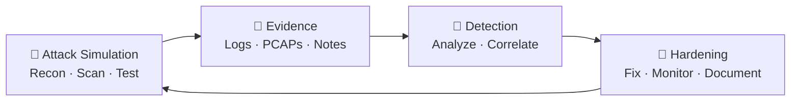

<!-- ═══════════════════════════════════════════════════════════════
     Karun H G — GitHub Profile README
     Theme: Hacker terminal (green on dark) | Red Team + Blue Team
     ═══════════════════════════════════════════════════════════════ -->

<div align="center">


<a href="https://git.io/typing-svg">
  
</a>

<br/>


<br/>

[**▸ About**](#-about) &nbsp;•&nbsp;
[**▸ Red Team**](#-offensive-security-red-team) &nbsp;•&nbsp;
[**▸ Blue Team**](#-defensive-security-blue-team) &nbsp;•&nbsp;
[**▸ AI Security**](#-ai-security) &nbsp;•&nbsp;
[**▸ Projects**](#-featured-projects) &nbsp;•&nbsp;
[**▸ Stack**](#-tech-stack) &nbsp;•&nbsp;
[**▸ Contact**](#-contact)

</div>

---

## 🖥️ About

```bash
karun@kali-lab:~$ cat profile.json
```

```json
{
  "name": "Karun H G",
  "education": "MCA Student",
  "roles": ["Cybersecurity Learner", "Software Developer", "Aspiring AI Security Engineer"],
  "currently_learning": ["SOC Operations", "Network Forensics (TShark/PCAP)", "DNS Recon", "AI Red-Teaming"],
  "currently_building": ["Post-Quantum Secure File Vault", "Bayora (AI Safety Testing)"],
  "lab": "Kali Linux + isolated practice environments",
  "workflow": "Observe -> Investigate -> Validate -> Document -> Improve",
  "goal": "Security Engineering / SOC / AI Security roles",
  "open_to": ["Internships", "Collaboration", "Mentorship", "CTF teams"]
}
```

> 💡 I build software, break it **ethically** in controlled labs, and then learn how to defend it. All offensive work is performed only on systems I own or have explicit permission to test.

---

## ⚔️ Offensive Security (Red Team)

*Understanding the attacker's mindset to build better defenses.*

<table>
<tr>
<td width="50%" valign="top">

### 🎯 Focus Areas
- Reconnaissance & enumeration
- DNS reconnaissance
- Web application security basics
- Network scanning & service discovery
- Vulnerability assessment fundamentals
- Adversarial testing of AI systems

</td>
<td width="50%" valign="top">

### 🧰 Tooling (Lab Use)
- `nmap` &nbsp;•&nbsp; `dig` / `nslookup`
- `Burp Suite` &nbsp;•&nbsp; `OWASP ZAP`
- `Metasploit` (lab only)
- `gobuster` / `ffuf`
- `Kali Linux` toolchain

</td>
</tr>
</table>

<details>
<summary><b>🔓 Click to expand — My ethical hacking approach</b></summary>
<br/>

| Phase | What I practice |
|:--|:--|
| **1. Recon** | Passive/active information gathering, DNS records, subdomain discovery |
| **2. Scanning** | Port/service enumeration, version detection |
| **3. Analysis** | Mapping findings to known weakness classes (OWASP Top 10) |
| **4. Validation** | Confirming issues safely in lab environments |
| **5. Reporting** | Evidence, impact, remediation guidance |

**Ground rules:** authorized targets only • isolated labs • responsible disclosure • documentation over destruction.

</details>

---

## 🛡️ Defensive Security (Blue Team)

*Detect. Investigate. Respond. Harden.*

<table>
<tr>
<td width="50%" valign="top">

### 🔎 Focus Areas
- SOC operations & alert triage
- Network traffic analysis (PCAP)
- TLS / SNI / QUIC traffic inspection
- Threat detection & log analysis
- Incident analysis & evidence handling
- Secure system design

</td>
<td width="50%" valign="top">

### 🧰 Tooling
- `TShark` / `Wireshark`
- `tcpdump`
- Linux CLI (`grep`, `awk`, `jq`)
- Log analysis workflows
- SIEM concepts (detection, correlation)

</td>
</tr>
</table>

<details>
<summary><b>📡 Click to expand — Sample investigation workflow</b></summary>
<br/>

```bash
# 1. Overview of protocols in a capture
tshark -r capture.pcap -q -z io,phs

# 2. Extract TLS Server Name Indication (SNI)
tshark -r capture.pcap -Y "tls.handshake.type == 1" \
       -T fields -e ip.src -e tls.handshake.extensions_server_name

# 3. Review DNS queries
tshark -r capture.pcap -Y "dns.flags.response == 0" \
       -T fields -e frame.time -e ip.src -e dns.qry.name

# 4. Identify QUIC traffic
tshark -r capture.pcap -Y "quic"
```

**Method:** Observe → Investigate → Validate → Document → Improve.

</details>

<details>
<summary><b>🔁 Click to expand — Red Team ⇄ Blue Team loop</b></summary>
<br/>



Every offensive experiment becomes a defensive lesson.

</details>

---

## 🤖 AI Security

Exploring how AI systems fail, and how to make them safer.

| Area | Description |
|:--|:--|
| 🔴 **Adversarial Testing** | Prompt injection, jailbreak-style probing, robustness checks (in controlled settings) |
| 🔵 **Defensive Evaluation** | Guardrails, evaluation pipelines, safety scoring |
| 🧱 **Secure AI Design** | Separation of attack and defense layers, least privilege for AI tools |

---

## 🚀 Featured Projects

<table>
<tr>
<td width="50%" valign="top">

### 🔐 Post-Quantum Secure File Vault
Security-focused file storage exploring post-quantum cryptography concepts.


</td>
<td width="50%" valign="top">

### 🛡️ Bayora — AI Safety Testing
Red-team / blue-team infrastructure that separates attack attempts from defensive evaluation of AI systems.

[](https://github.com/Karunpoojari7/Bayora_Sec)

</td>
</tr>
<tr>
<td width="50%" valign="top">

### 🌐 SOC Analyst Journey
Packet analysis, command references, observations, and evidence-based reports.

[](https://github.com/Karunpoojari7/soc-analyst-journey)

</td>
<td width="50%" valign="top">

### 📊 Insight AI
AI-powered analytics chatbot and dashboard concept for exploring data in plain language.


</td>
</tr>
<tr>
<td colspan="2" valign="top">

### 🎓 GMU Connect 2.0
Student-focused mobile app initiative with academic APIs, authentication, and a React Native + TypeScript foundation.

</td>
</tr>
</table>

> *Project status varies: some are ongoing or exploratory. Check each repository for details.*

---

## 🧰 Tech Stack

<details open>
<summary><b>💻 Languages</b></summary>
<br/>


</details>

<details open>
<summary><b>🌐 Web & Backend</b></summary>
<br/>


</details>

<details open>
<summary><b>🗄️ Databases, DevOps & Platforms</b></summary>
<br/>


</details>

<details open>
<summary><b>🔐 Security Toolkit</b></summary>
<br/>


</details>

*A selected list of technologies I have worked with or am actively learning, not a claim of expert-level proficiency in every tool.*

---

## 🗺️ Roadmap

- [x] Network traffic analysis with TShark & PCAP
- [x] TLS / SNI / QUIC inspection basics
- [x] DNS reconnaissance & Linux fundamentals
- [ ] SOC detection engineering & SIEM labs
- [ ] Web app penetration testing (OWASP Top 10)
- [ ] CTF participation (TryHackMe / Hack The Box)
- [ ] Security certifications (e.g. Security+, BTL1, eJPT)
- [ ] AI red-teaming & LLM security research

---

## 📈 GitHub Activity

<div align="center">


</div>

---

## 📫 Contact

<div align="center">

[](https://in.linkedin.com/in/karun-poojari-uiux)
[](https://github.com/Karunpoojari7)

```bash
karun@kali-lab:~$ echo "Building with curiosity. Learning through practice. Designing with security in mind."
```


</div>
