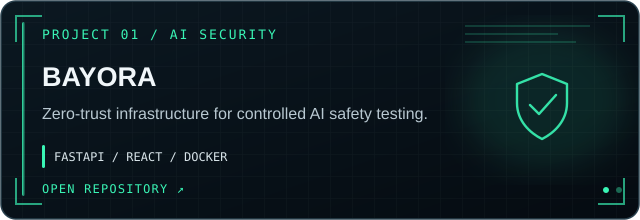
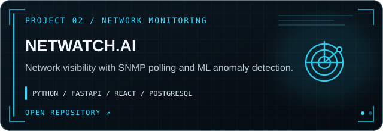
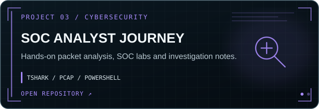
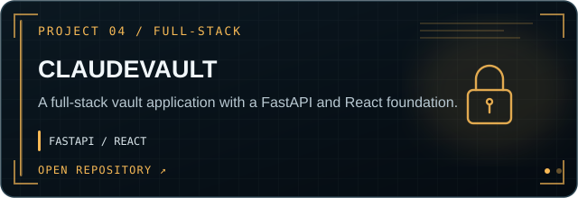
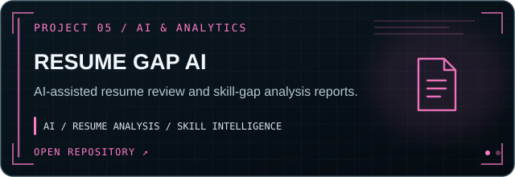
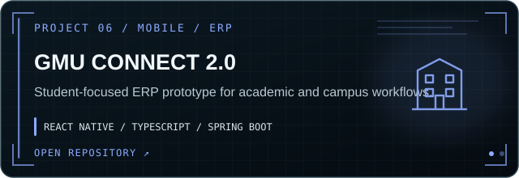
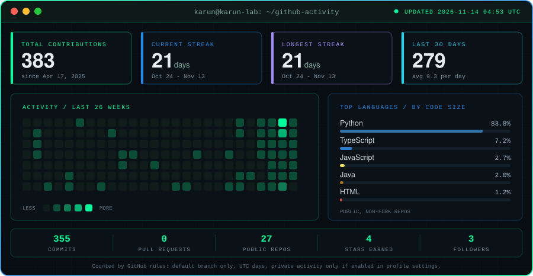

<div align="center">


<br/>


<br/>


<br/>

[](https://github.com/Karunpoojari7)
[](https://in.linkedin.com/in/karun-poojari-uiux)
[](#03--featured-projects)
[](#07--lets-connect)

</div>

<br/>

> **I want to understand how systems break, so I can build ones that don't.**
> MCA student focused on cybersecurity, network forensics and AI security. I learn by building, investigating and documenting.

---

## `01 // The person behind the code`

<div align="center">



</div>

<br/>

---

## `02 // Inside my security lab`

I organize my work around three connected areas: attack the surface, collect evidence, then harden what I find.

<div align="center">


<br/>

*Every ethical offensive experiment can become a defensive lesson.*

</div>

<details>
<summary><b>📡&nbsp; Sample investigation workflow (TShark)</b> &nbsp;·&nbsp; <sub>tap to expand</sub></summary>
<br/>

```bash
# Protocol hierarchy of a capture
tshark -r capture.pcap -q -z io,phs

# Extract TLS Server Name Indication (SNI)
tshark -r capture.pcap -Y "tls.handshake.type == 1" \
       -T fields -e ip.src -e tls.handshake.extensions_server_name

# Review DNS queries
tshark -r capture.pcap -Y "dns.flags.response == 0" \
       -T fields -e frame.time -e ip.src -e dns.qry.name

# Identify QUIC traffic
tshark -r capture.pcap -Y "quic"
```

</details>

---


## `03 // Featured projects`

<p><i>Selected work across cybersecurity, AI and software engineering. Select a card to open its repository, or expand the details below it.</i></p>

<table>
<tr>
<td width="50%" valign="top">
<a href="https://github.com/Karunpoojari7/Bayora_Sec"></a>
<details>
<summary><b>Technical details</b> · BAYORA</summary>

Isolated Red Team, Target LLM and Blue Team environments, with an evidence-focused security evaluation workflow.

<a href="https://github.com/Karunpoojari7/Bayora_Sec">Open repository ↗</a>
</details>
</td>
<td width="50%" valign="top">
<a href="https://github.com/Karunpoojari7/NETWATCH"></a>
<details>
<summary><b>Technical details</b> · NETWATCH.AI</summary>

Full-stack monitoring platform with a real-time dashboard, traffic visibility and anomaly detection components.

<a href="https://github.com/Karunpoojari7/NETWATCH">Open repository ↗</a>
</details>
</td>
</tr>
<tr>
<td width="50%" valign="top">
<a href="https://github.com/Karunpoojari7/Soc-Analyst-Journey"></a>
<details>
<summary><b>Technical details</b> · SOC ANALYST JOURNEY</summary>

Documented learning labs covering packet inspection, DNS and TLS analysis, SIEM practice and sanitized evidence.

<a href="https://github.com/Karunpoojari7/Soc-Analyst-Journey">Open repository ↗</a>
</details>
</td>
<td width="50%" valign="top">
<a href="https://github.com/Karunpoojari7/QuantumValut"></a>
<details>
<summary><b>Technical details</b> · CLAUDEVAULT</summary>

The repository README identifies the application as ClaudeVault. The repository name is QuantumValut; the README does not currently substantiate a post-quantum cryptography claim.

<a href="https://github.com/Karunpoojari7/QuantumValut">Open repository ↗</a>
</details>
</td>
</tr>
<tr>
<td width="50%" valign="top">
<a href="https://github.com/Karunpoojari7/Resume_Gap_AI"></a>
<details>
<summary><b>Technical details</b> · RESUME GAP AI</summary>

An AI-powered SkillForge application designed to analyze resume gaps and produce professional optimization reports.

<a href="https://github.com/Karunpoojari7/Resume_Gap_AI">Open repository ↗</a>
</details>
</td>
<td width="50%" valign="top">
<a href="https://github.com/Karunpoojari7/GMU-CONNECT-APP"></a>
<details>
<summary><b>Technical details</b> · GMU CONNECT 2.0</summary>

A student ERP prototype with a mobile application, admin portal and backend API architecture. It is a demonstration project, not a live university ERP integration.

<a href="https://github.com/Karunpoojari7/GMU-CONNECT-APP">Open repository ↗</a>
</details>
</td>
</tr>
</table>

<sub>Project descriptions reflect the current repository documentation. The card artwork is static; repository links and expandable details are native GitHub README interactions.</sub>


## `04 // My technology toolkit`

<div align="center">

**Languages & Development**<br/>


**Frameworks**<br/>


**Databases & Tools**<br/>


**Systems**<br/>


**Security Tools**<br/>


</div>

<sub>Tools listed are ones I have used or am actively learning. They do not imply expert-level proficiency in every item.</sub>

---

## `05 // Learning roadmap`

Where I am and what comes next, grouped by progress.

<table>
<tr>
<th width="33%">✅ Completed</th>
<th width="33%">🔄 In progress</th>
<th width="33%">🎯 Planned</th>
</tr>
<tr>
<td valign="top">
<ul>
<li>Network traffic analysis</li>
<li>TShark and PCAP fundamentals</li>
<li>TLS / SNI / QUIC inspection</li>
<li>DNS reconnaissance</li>
<li>Linux fundamentals</li>
</ul>
</td>
<td valign="top">
<ul>
<li>SOC detection engineering</li>
<li>SIEM lab practice</li>
<li>OWASP Top 10</li>
<li>Web application security</li>
<li>CTF practice (TryHackMe / Hack The Box)</li>
</ul>
</td>
<td valign="top">
<ul>
<li>Advanced incident response</li>
<li>AI red teaming and LLM security research</li>
<li>Applied cryptography research</li>
<li>Security+ / BTL1 / eJPT preparation</li>
</ul>
</td>
</tr>
</table>

---

## `06 // GitHub activity`

<div align="center">



<sub>Auto-refreshed every 6 hours by GitHub Actions directly from the GitHub API. No third-party stat services.</sub>

</div>
<br/>

---

## `07 // Let's connect`

<div align="center">

Open to learning, collaboration, mentorship and cybersecurity opportunities.

<br/>

<a href="https://in.linkedin.com/in/karun-poojari-uiux"></a>
&nbsp;&nbsp;
<a href="https://github.com/Karunpoojari7?tab=repositories"></a>

<br/>



</div>
