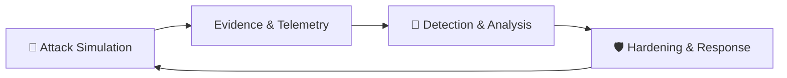

 <!-- ═══════════════════════════════════════════════════════════════
  KARUN H G | CYBERSECURITY PROFILE
  DARK OPERATIONS CONSOLE • RED TEAM × BLUE TEAM × AI SECURITY
═══════════════════════════════════════════════════════════════ -->

<div align="center">


<br/>


<br/>


<br/>

[⌁ SYSTEM](#-01--system-identity) • [🔴 RED TEAM](#-02--red-team) • [🔵 BLUE TEAM](#-03--blue-team) • [🤖 AI SECURITY](#-04--ai-security) • [PROJECTS](#-05--featured-projects) • [STACK](#-06--technology-stack) • [ROADMAP](#-07--research-roadmap) • [CONTACT](#-09--connect)

</div>

---

## `01 // SYSTEM IDENTITY`

<div align="center">

`root@karun-lab:~$ ./initialize_profile.sh`

</div>

<table>
<tr>
<td width="62%" valign="top">

### `TERMINAL // profile.json`


```json
{
  "name": "Karun H G",
  "education": "MCA Student",
  "roles": [
    "Cybersecurity Learner",
    "Software Developer",
    "Aspiring AI Security Engineer"
  ],
  "focus": [
    "SOC & DFIR",
    "Network Forensics",
    "AI Security"
  ],
  "learning": [
    "Threat Detection",
    "DNS Recon",
    "AI Red Teaming"
  ],
  "building": [
    "Post-Quantum Secure File Vault",
    "Bayora"
  ],
  "workflow": "Observe -> Investigate -> Validate -> Document"
}
```

</td>
<td width="38%" valign="top">

### `SYSTEM.STATUS`


**> kernel** : Kali Linux

**> domains** : Cybersecurity

**> interests** : Red / Blue / AI

**> workflow** : Evidence-led

**> availability** : Open to opportunities

---

### `OPERATING PRINCIPLE`

Understand how systems fail. Learn how attacks work. Build better defenses.

</td>
</tr>
</table>

I build software, explore security vulnerabilities in controlled environments, and study how systems can be protected against real-world threats. My interests span offensive security, defensive security, network forensics, cryptography and AI security.

> **Ethical boundary:** All offensive testing is performed only on systems I own or have explicit permission to test.

---

## `02 // RED TEAM`

<div align="center">


*Think like an attacker. Test ethically. Document evidence.*

</div>

<table>
<tr>
<td width="50%" valign="top">

### 🎯 ATTACK SURFACE

- Reconnaissance & enumeration
- DNS reconnaissance
- Network scanning & service discovery
- Web application security fundamentals
- Vulnerability assessment
- Adversarial AI testing

</td>
<td width="50%" valign="top">

### 🧰 TOOLKIT // LAB USE

- `Nmap`
- `Burp Suite`
- `OWASP ZAP`
- `Metasploit`
- `gobuster` / `ffuf`
- `dig` / `nslookup`
- `Kali Linux`

</td>
</tr>
</table>

<details>
<summary><b>▸ EXPAND // Ethical hacking methodology</b></summary>

| Stage | Practice |
|:--|:--|
| 01 — Recon | Information gathering and DNS discovery |
| 02 — Scan | Port and service enumeration |
| 03 — Analyze | Identify potential security weaknesses |
| 04 — Validate | Verify safely in an authorized lab |
| 05 — Report | Evidence, impact and remediation |

**Ground rules:** Authorized targets · Controlled environments · Responsible disclosure · Evidence-based reporting.

</details>

---

## `03 // BLUE TEAM`

<div align="center">


*Detect. Investigate. Respond. Harden.*

</div>

<table>
<tr>
<td width="50%" valign="top">

### 🔎 DEFENSIVE OPERATIONS

- SOC operations & alert triage
- Network traffic analysis
- PCAP investigation
- TLS / SNI / QUIC inspection
- Threat detection & log analysis
- Incident investigation
- Secure system design

</td>
<td width="50%" valign="top">

### 🧰 DEFENSIVE TOOLKIT

- `Wireshark`
- `TShark`
- `tcpdump`
- Linux CLI
- `grep` / `awk` / `jq`
- Log analysis workflows
- SIEM concepts

</td>
</tr>
</table>

<details>
<summary><b>▸ EXPAND // Sample network investigation</b></summary>

```bash
# 01 — Protocol overview
tshark -r capture.pcap -q -z io,phs

# 02 — Extract TLS SNI
tshark -r capture.pcap -Y "tls.handshake.type == 1" \
  -T fields -e ip.src -e tls.handshake.extensions_server_name

# 03 — Review DNS queries
tshark -r capture.pcap -Y "dns.flags.response == 0" \
  -T fields -e frame.time -e ip.src -e dns.qry.name

# 04 — Identify QUIC traffic
tshark -r capture.pcap -Y "quic"
```

**Investigation loop:** Observe → Investigate → Validate → Document → Improve.

</details>

<details>
<summary><b>▸ EXPAND // Red Team ⇄ Blue Team feedback loop</b></summary>



Every ethical offensive experiment can become a defensive lesson.

</details>

---

## `04 // AI SECURITY`

<div align="center">


**Exploring how intelligent systems fail — and how to make them safer.**

</div>

| Research track | Exploration |
|:--|:--|
| 🔴 Adversarial testing | Prompt injection, jailbreak-style probing and robustness checks in controlled settings |
| 🔵 Defensive evaluation | Guardrails, evaluation pipelines and safety scoring |
| 🛡️ Secure AI design | Separation of attack and defense layers; least privilege for AI tools |
| 🧪 AI safety | Understanding failure modes and improving reliability |

---

## `05 // FEATURED PROJECTS`

*Practical builds at the intersection of software, security and research.*

<table>
<tr>
<td width="50%" valign="top">

### 🔐 POST-QUANTUM SECURE FILE VAULT

Security-focused file storage exploring post-quantum cryptography concepts.


</td>
<td width="50%" valign="top">

### 🛡️ BAYORA — AI SAFETY TESTING

Red Team / Blue Team infrastructure separating attack attempts from defensive evaluation of AI systems.

[](https://github.com/Karunpoojari7/Bayora_Sec)

</td>
</tr>
<tr>
<td width="50%" valign="top">

### 🌐 SOC ANALYST JOURNEY

Packet analysis, command references, observations and evidence-based reports.

[](https://github.com/Karunpoojari7/Soc-Analyst-Journey)

</td>
<td width="50%" valign="top">

### 📊 INSIGHT AI

AI-powered analytics chatbot and dashboard concept for exploring data in plain language.


</td>
</tr>
<tr>
<td colspan="2" valign="top">

### 🎓 GMU CONNECT 2.0

Student-focused mobile app initiative with academic APIs, authentication, and a React Native + TypeScript foundation.

</td>
</tr>
</table>

<sub>Some projects are ongoing or exploratory. Repository links are included where available; see each project for implementation details.</sub>

---

## `06 // TECHNOLOGY STACK`

*An open stack — grouped by discipline, not boxed into a badge wall.*

### ⌁ LANGUAGES


### ⌁ WEB & BACKEND


### ⌁ DATA, DEVOPS & PLATFORMS


### ⌁ SECURITY TOOLING


<sub>Technologies listed are tools I have worked with or am actively learning; this is not a claim of expert-level proficiency in every item.</sub>

---

## `07 // RESEARCH ROADMAP`

*Progress is tracked through practical work, not just checkboxes.*

| State | Track |
|:--:|:--|
| 🟢 Done | Network traffic analysis with TShark & PCAP |
| 🟢 Done | TLS / SNI / QUIC inspection basics |
| 🟢 Done | DNS reconnaissance & Linux fundamentals |
| 🔵 In progress | SOC detection engineering & SIEM labs |
| 🔵 In progress | Web application security — OWASP Top 10 |
| 🔵 In progress | CTF practice — TryHackMe / Hack The Box |
| ⚪ Planned | Security certifications — Security+, BTL1, eJPT |
| ⚪ Planned | AI red-teaming & LLM security research |

---

## `08 // GITHUB ACTIVITY`

<div align="center">


<br/>


</div>

---

## `09 // CONNECT`

<div align="center">

`root@karun-lab:~$ ./connect.sh`

**Open to learning, collaboration, mentorship and cybersecurity opportunities.**

<br/>

[](https://in.linkedin.com/in/karun-poojari-uiux)
[](https://github.com/Karunpoojari7)

<br/>

```bash
karun@kali-lab:~$ echo "Building with curiosity."
karun@kali-lab:~$ echo "Learning through practice."
karun@kali-lab:~$ echo "Designing with security in mind."
```

**OBSERVE  /  INVESTIGATE  /  VALIDATE  /  SECURE**


</div>
