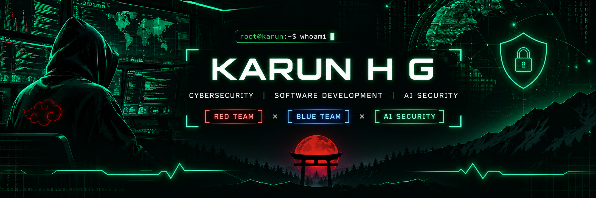
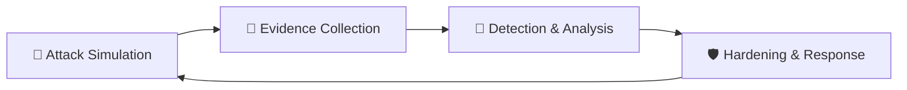

 <!-- ═══════════════════════════════════════════════════════════════
     KARUN H G | CYBERSECURITY PROFILE
     Dark Cyber Operations | Red Team × Blue Team × AI Security
     ═══════════════════════════════════════════════════════════════ -->

<div align="center">



<br/>


<br/>


<br/>

`[ RED TEAM ]` &nbsp; × &nbsp; `[ BLUE TEAM ]` &nbsp; × &nbsp; `[ AI SECURITY ]`

<br/>

[ABOUT](#-system-identity) &nbsp; • &nbsp;
[RED TEAM](#-red-team--offensive-security) &nbsp; • &nbsp;
[BLUE TEAM](#-blue-team--defensive-security) &nbsp; • &nbsp;
[AI SECURITY](#-ai-security) &nbsp; • &nbsp;
[PROJECTS](#-featured-projects) &nbsp; • &nbsp;
[CONTACT](#-connect)

</div>

---

## `01 // SYSTEM IDENTITY`

<div align="center">

### `root@karun-lab:~$ whoami`

</div>

<table>
<tr>
<td width="55%" valign="top">

**Karun H G**

MCA Student | Cybersecurity Learner | Software Developer | Aspiring AI Security Engineer

I build software, explore security vulnerabilities in controlled environments, and study how systems can be protected against real-world threats.

My interests span offensive security, defensive security, network forensics, cryptography and AI security.

**Current mission:** Learn through practical experimentation, build meaningful security projects, and document every discovery.

</td>
<td width="45%" valign="top">

### `system.info`

```yaml
name: Karun H G
education: MCA Student

environment:
  - Kali Linux
  - Isolated Lab Environments

currently_learning:
  - SOC Operations
  - Network Forensics
  - DNS Reconnaissance
  - AI Red Teaming

currently_building:
  - Post-Quantum Secure File Vault
  - Bayora

workflow:
  - Observe
  - Investigate
  - Validate
  - Document
  - Improve

open_to:
  - Internships
  - Collaboration
  - Mentorship
  - CTF Teams
```

</td>
</tr>
</table>

> **Operating principle:** Understand how systems fail. Learn how attacks work. Build better defenses. All offensive testing is performed only on systems I own or have explicit permission to test.

---

## `02 // RED TEAM — OFFENSIVE SECURITY`

<text></text>

<div align="center">

<kbd> RECONNAISSANCE </kbd> &nbsp; <kbd> ENUMERATION </kbd> &nbsp; <kbd> VULNERABILITY ANALYSIS </kbd>

</div>

*Understanding the attacker's mindset to build stronger defenses.*

<table>
<tr>
<td width="50%" valign="top">

### 🔴 Attack Surface Exploration

- Reconnaissance and enumeration
- DNS reconnaissance
- Network scanning and service discovery
- Web application security fundamentals
- Vulnerability assessment
- Adversarial AI testing

</td>
<td width="50%" valign="top">

### 🧰 Security Toolkit

- `Nmap`
- `Burp Suite`
- `OWASP ZAP`
- `Metasploit` — lab use
- `gobuster` / `ffuf`
- `dig` / `nslookup`
- `Kali Linux`

</td>
</tr>
</table>

<details>
<summary><b>🔓 Explore my ethical hacking methodology</b></summary>

| Phase | Activity |
|:--|:--|
| 01 — Recon | Information gathering and DNS discovery |
| 02 — Scanning | Port and service enumeration |
| 03 — Analysis | Identifying potential security weaknesses |
| 04 — Validation | Safely verifying findings in a lab |
| 05 — Reporting | Evidence, impact and remediation |

**Ground rules:** Authorized targets only · Controlled environments · Responsible disclosure · Evidence-based reporting.

</details>

---

## `03 // BLUE TEAM — DEFENSIVE SECURITY`

<div align="center">

<kbd> MONITOR </kbd> &nbsp; <kbd> DETECT </kbd> &nbsp; <kbd> INVESTIGATE </kbd> &nbsp; <kbd> RESPOND </kbd>

</div>

*Detect. Investigate. Respond. Harden.*

<table>
<tr>
<td width="50%" valign="top">

### 🔵 Defensive Focus

- SOC operations and alert triage
- Network traffic analysis
- PCAP investigation
- TLS / SNI / QUIC inspection
- Threat detection and log analysis
- Incident investigation
- Secure system design

</td>
<td width="50%" valign="top">

### 🧰 Defensive Toolkit

- `Wireshark`
- `TShark`
- `tcpdump`
- Linux CLI
- `grep` / `awk` / `jq`
- Log analysis workflows
- SIEM concepts

</td>
</tr>
</table>

<details>
<summary><b>📡 Explore a sample network investigation workflow</b></summary>

```bash
# 01 - Protocol overview
tshark -r capture.pcap -q -z io,phs

# 02 - Extract TLS Server Name Indication
tshark -r capture.pcap \
-Y "tls.handshake.type == 1" \
-T fields -e ip.src \
-e tls.handshake.extensions_server_name

# 03 - Review DNS queries
tshark -r capture.pcap \
-Y "dns.flags.response == 0" \
-T fields -e frame.time -e ip.src -e dns.qry.name

# 04 - Identify QUIC traffic
tshark -r capture.pcap -Y "quic"
```

**Investigation workflow:** Observe → Investigate → Validate → Document → Improve.

</details>

<details>
<summary><b>🔁 Red Team ⇄ Blue Team security cycle</b></summary>



Every offensive experiment can become a defensive lesson.

</details>

---

## `04 // AI SECURITY`

<div align="center">

### 🤖 Exploring the security of intelligent systems

`AI RED TEAMING` &nbsp; × &nbsp; `AI DEFENSE` &nbsp; × &nbsp; `SECURE AI DESIGN`

</div>

| Research Area | Exploration |
|:--|:--|
| 🔴 Adversarial Testing | Prompt injection, jailbreak-style probing and robustness testing in controlled settings |
| 🔵 Defensive Evaluation | Guardrails, evaluation pipelines and safety scoring |
| 🛡️ Secure AI Design | Separation of attack and defense layers, least privilege for AI tools |
| 🧪 AI Safety | Understanding failure modes and improving system reliability |

---

## `05 // FEATURED PROJECTS`

*Building practical solutions through software development and security research.*

<table>
<tr>
<td width="50%" valign="top">

### 🔐 Post-Quantum Secure File Vault

Security-focused file storage exploring post-quantum cryptography concepts.


</td>
<td width="50%" valign="top">

### 🛡️ Bayora — AI Safety Testing

Red Team / Blue Team infrastructure that separates attack attempts from defensive evaluation of AI systems.

[](https://github.com/Karunpoojari7/Bayora_Sec)

</td>
</tr>
<tr>
<td width="50%" valign="top">

### 🌐 SOC Analyst Journey

A practical learning journey covering packet analysis, command references, observations and evidence-based reports.

[](https://github.com/Karunpoojari7/Soc-Analyst-Journey)

</td>
<td width="50%" valign="top">

### 📊 Insight AI

AI-powered analytics chatbot and dashboard concept for exploring data in plain language.


</td>
</tr>
<tr>
<td colspan="2" valign="top">

### 🎓 GMU Connect 2.0

Student-focused mobile app initiative with academic APIs, authentication, and a React Native + TypeScript foundation.

</td>
</tr>
</table>

> Project status varies: some projects are ongoing or exploratory. Visit their repositories for implementation details.

---

## `06 // TECHNOLOGY STACK`

<details open>
<summary><b>💻 Programming Languages</b></summary>
<br/>


</details>

<details open>
<summary><b>🌐 Web Development & Backend</b></summary>
<br/>


</details>

<details open>
<summary><b>🗄️ Databases, DevOps & Platforms</b></summary>
<br/>


</details>

<details open>
<summary><b>🔐 Cybersecurity Toolkit</b></summary>
<br/>


</details>

<sub>A selected list of technologies I have worked with or am actively learning, not a claim of expert-level proficiency in every tool.</sub>

---

## `07 // SECURITY RESEARCH ROADMAP`

*Learning through practical exploration and continuous improvement.*

| Status | Research / Learning Area |
|:--:|:--|
| ✅ | Network traffic analysis with TShark & PCAP |
| ✅ | TLS / SNI / QUIC inspection basics |
| ✅ | DNS reconnaissance & Linux fundamentals |
| 🔄 | SOC detection engineering & SIEM labs |
| 🔄 | Web application security — OWASP Top 10 |
| 🔄 | CTF practice — TryHackMe / Hack The Box |
| 🔄 | Security certifications — Security+, BTL1, eJPT |
| 🔄 | AI red-teaming & LLM security research |

---

## `08 // GITHUB ACTIVITY`

<div align="center">


<br/>


</div>

---

## `09 // CONNECT`

<div align="center">

### `root@karun-lab:~$ ./connect.sh`

Open to learning, collaboration, mentorship and cybersecurity opportunities.

<br/>

[](https://in.linkedin.com/in/karun-poojari-uiux)
[](https://github.com/Karunpoojari7)

<br/>

```bash
karun@kali-lab:~$ echo "Building with curiosity."
karun@kali-lab:~$ echo "Learning through practice."
karun@kali-lab:~$ echo "Designing with security in mind."
```

**OBSERVE. INVESTIGATE. VALIDATE. SECURE.**


</div>
